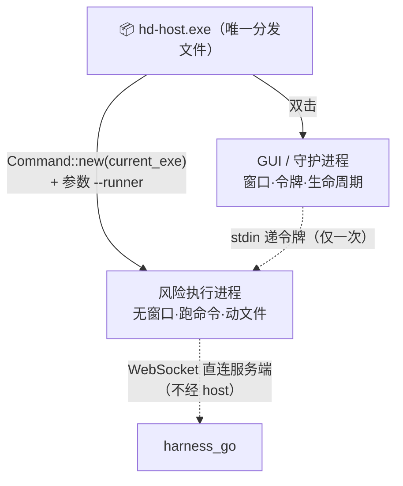

# harness_desktop 架构与功能设计

> 本文档是 `harness_desktop` 的**权威架构基线**。代码注释中大量引用本文的
> §3.2 / §14.x / §16 / §17.x / §18.4 / §19，此处补全以保证「注释指向的文档真实存在」。
>
> **文档状态**：2026-11 重写。此前该文件缺失，导致 12 处代码注释指向空指针。
> 本次依据当前真实代码与实测结论重建，并把已推翻的历史结论显式保留（见各节「历史误解」框）。

---

## §1 定位与边界

`harness_desktop` 是 AI Agent 系统的**桌面端重执行工位**。

**它不是一个聊天客户端。** 对话入口在 `harness_go/web`（浏览器）与 `harness_mobile`。
桌面端跑在开发者自己的机器上，把服务端下发的任务在**本地真实环境**中执行并回传。

```
对话（Web / 移动端）  ──▶  harness_go（服务端，发号施令）
                                   │
                                   ▼ WebSocket task.dispatch
                          hd-host.exe --runner（本机执行）
                                   │
                                   ▼ Guarded 三闸校验后
                            本地磁盘 / 外部进程
```

### §1.1 桌面端**不负责**的事

| 不做 | 原因 |
| --- | --- |
| 渲染对话界面 | 内置 UI 只有 3 个按钮 + 2 个状态块（`web/src/baseline/main.ts`），定位是「最小基线 + 远程热更」 |
| 持有模型/会话数据 | 全在服务端，桌面端只执行 |
| 自行连接服务端派发任务 | 连的是 `harness_go` 的 `/api/v1/devices/ws`，与 Web 前端的 API 是两套 |

---

## §2 单包分发（2026-11 决策）

### §2.1 结论

**分发产物只有一个文件：`hd-host.exe`。**
运行起来是**两个进程**：



- **文件数量 1**，因为 runner 代码被静态链接进同一个 exe；
- **进程数量 2**，因为执行面必须与界面隔离（§3.2）。

### §2.2 代码层 vs 应用层（两个不同的「引用」）

`hd-host` 对 `hd-runner` 有**两层引用**，不可混淆：

| 层 | 形式 | 位置 | 含义 |
| --- | --- | --- | --- |
| **代码层**（编译期） | `hd-runner = { path = "../hd-runner" }` | `hd-host/Cargo.toml` | 逻辑被**静态链接**进同一 exe |
| **应用层**（运行期） | `Command::new(exe).args(["--runner"])` | `daemon.rs::spawn` | 启动**独立进程**，内核级隔离 |

代码层生产引用共 4 处：

| 位置 | 引用 | 必要性 |
| --- | --- | --- |
| `main.rs` | `hd_runner::run_cli` | `--runner` 分支的唯一入口 |
| `daemon.rs` | `ReconnectPolicy` / `ReconnectDecision` | 退避口径两侧必须一致 |
| `pairing.rs` | `ipc::redact_token` | 令牌打码 |
| `vault.rs` | `ipc::redact_token` | Debug 脱敏 |

> ⚠️ **代码共享 ≠ 进程共享**。`hd-runner` 的代码在同一个 exe 里，但运行时是两个
> 各自独立的内存与 panic 域。

### §2.3 `--runner` 分流必须最先执行

```rust
fn main() {
    if is_runner_mode(args) {                // ← 第一行业务代码就分流
        std::process::exit(hd_runner::run_cli(..) as i32);
    }
    hd_host::gui::run()                      // 只有走到这里才初始化 GUI
}
```

**该分支内绝不触碰任何 `tauri::` API。** `tauri::Builder::run()` 会创建窗口、加载
WebView2、进入事件循环；一旦进入，进程就只能当 GUI 用。保持这条纪律的收益：
无 WebView2 的环境（服务器 / 精简系统）也能运行 `--runner`。

### §2.4 子系统取舍（console vs windows）

| 子系统 | GUI 双击 | 自派生 | 说明 |
| --- | --- | --- | --- |
| `windows` | 无黑框 | ❌ **加载期 `0xC0000139`** | 进程在 `main()` 之前就死，stderr 为空 |
| `console` | **闪一下黑框** | ✅ 正常（进 main()、读 stdin、退出码 2，约 51ms） | **本项目采用** |

> 🔴 **历史误解（已纠正）**：旧 `build-exe.ps1` 与 `bootstrap.rs` 曾断言
> 「Windows 上自派生必崩 0xC0000139」，并据此把 `allow_self_derive` 默认设为 `false`。
> 2026-11 用真实 spawn 探针（复刻 `Stdio::piped()` + 写 stdin）实测证明：
> **该结论只适用于 `windows` 子系统**，`console` 子系统下完全正常。
>
> **代价与取舍**：接受 GUI 双击时闪一下控制台窗口。`main.rs:32-46` 保留成因说明。
> 若将来要用 NSIS 快捷方式 `ShowWindow=Hidden` 隐藏，必须**同时保持 console 子系统**，
> 不要在 exe 层面改回 `windows_subsystem = "windows"`。

### §2.5 开发联调

```powershell
.\scripts\dev.ps1              # 构建 + 启动（唯一推荐入口）
.\scripts\dev.ps1 -NoLaunch    # 只构建（IDE 调试前）
.\scripts\dev.ps1 -WithWeb     # 连前端一起重建
```

**单包带来的关键收益**：历史上 `cargo run -p hd-host` 只编译 `hd-runner` 的 **lib**，
不产 bin，于是 GUI 会拉起一个陈旧的 `hd-runner.exe`，而 `cargo test` 全绿
（测试链接的是新 lib）—— **静默错配**。单包后该失效模式从根上消失。

**实测编译耗时**（Windows 本机）：无改动 0.78s / 改 runner lib 1.8s /
改 `gui.rs` 增量 7.4s / 首次全量 46s。

> 💡 **环境坑**：中断 `cargo build` 会污染 `target/debug/deps/*.pdb`，表现为
> `LNK1207 PDB 格式不兼容`。修复：删除该目录下所有 `.pdb`（可再生）后重建。

---

## §3 关键决策

### §3.1 为什么 Runner 是子进程而非同进程线程

执行面（fs / grep / exec）是整个系统最容易被攻破的部分，它面对用户的任意输入、
任意目录、任意程序。放进独立进程有两条收益：

1. **崩溃隔离**：恶意路径把 Runner 搞崩，Host 还活着，能重启并上报；
2. **权限可收窄**：将来可给 Runner 单独降权 / 加沙箱，Host 继续持有界面权限。

合并进程能省几十 MB 内存，但**用 UI 稳定性换，不划算**。

### §3.2 三条硬性语义（代码逐条落地）

1. **令牌只走 stdin**：不进 `argv`、不进环境变量。
   `argv` 与 `/proc/<pid>/environ` 在同机任何进程都可读，`ps` 也能看到；
   管道内容是父子间私有的。序列化时**不实现 `Serialize` 中间层**，
   用 `serde_json::json!` 直接塞临时 `Value`，随 `write_all` 结束即 drop。
2. **写端在发完 auth 后保持打开**：Runner 把「stdin EOF」当作「宿主已死」并自杀。
   若 Host 发完 auth 就关写端，Runner 会立刻误判为孤儿而退出（表现为「刚配对成功就掉线」）。
   正确做法是持有写端直到 Host 进程整体退出 → OS 关闭管道 → 子进程读到 EOF。
   **这也正是崩溃场景防孤儿的关键**：Host 崩溃时 OS 无条件关闭其持有的写端，
   Runner 一定能读到 EOF 并自杀，不依赖 Host 做任何清理动作。
3. **输出进限长 ring buffer**：Runner 的 stderr 可能疯狂刷屏，无界 `Vec` 会把
   Host 的 RSS 撑爆。上限 200 行（200 × 2 KiB ≈ 400 KiB）。

### §3.3 为什么 Host 不在任务数据通路上

任务帧由服务端**直接**发到 Runner 的 WebSocket 上，Host 全程不经手。理由：

| 收益 | 说明 |
| --- | --- |
| **安全** | 任务内容可能含敏感路径/文件内容。Host 的界面层跑着 WebView（更可能被攻破），任务若流经 Host，攻破界面即可篡改任务、伪造结果 |
| **性能** | 结果可能很大（grep 数千行），中转纯属浪费内存与延迟 |
| **隔离** | Host 全崩，Runner 手上当前任务仍能跑完再回传 |

Host 只做**控制面**：spawn、递令牌（一次）、`reload_policy`、`wait_exit`、`shutdown`、
读状态给界面。**它不传话，只发工牌、开门、盯着别晕倒。**

---

## §14 客户端分层

### §14.1 Crate 结构

| Crate | 职责 | 关键红线 |
| --- | --- | --- |
| `hd-protocol` | 设备协议线格式唯一来源（Go 侧 `internal/device/protocol.go` 的 Rust 镜像） | 禁止依赖 tokio / reqwest / keyring / std::fs —— 协议包不许碰 IO |
| `hd-core` | 执行器地基：`Executor` trait、`Guarded` 安全闸门、`Policy` 路径三闸、结果脱敏 | 无网络依赖；安全逻辑必须可离线单测 |
| `hd-runner` | **纯 lib**：WS 客户端、帧路由、退避重连、幂等缓存、stdin JSONL 控制协议 | 唯一能执行外部进程的 crate，一律经 `Guarded` |
| `hd-host` | 桌面宿主壳：token vault、配对、runner 守护、生命周期、GUI | GUI 层由 `gui` feature 控制，**默认不编译** |
| `hd-testkit` | 测试替身：假服务端 | 仅 `[dev-dependencies]` |

**依赖方向**：`hd-host → hd-runner → hd-core → hd-protocol`，单向无环。

### §14.2 `hd-core` 的三条硬性约束（写在类型系统里）

1. **无网络依赖**：依赖树里没有 reqwest / tokio-tungstenite，tokio 也不启用 `net`
   → 安全逻辑可在断网机器完整单测。
2. **端侧结果恒不可信**：`SourceTrust` 只有 `Untrusted` 一个变体，
   「把结果标成可信」在 Rust 里**无法构造**。
3. **端侧永不直写 DB**：审计走 `security::guard::AuditSink` 本地 sink，
   本 crate 不认识任何数据库 / HTTP 类型。

唯一合法执行入口是 `security::guard::Guarded<E>`：router 只持有它，拿不到裸 executor，
因此**绕过安全闸门在类型层面不可能发生**。

### §14.3 依赖红线

| Crate | 禁止引入 | 理由 |
| --- | --- | --- |
| `hd-protocol` | tokio / reqwest / keyring / std::fs | 协议包纯数据，不得有 IO |
| `hd-core` | 网络栈（reqwest、tokio 的 `net` feature） | 保证安全逻辑可离线单测 |
| `hd-testkit` | 出现在 `[dependencies]` | 只允许 `[dev-dependencies]` |

### §14.5 内置最小基线 UI

`web/src/baseline/main.ts` 只承诺四件事：

1. 能渲染（哪怕脚本挂了也有静态骨架兜住）；
2. 能展示连接错误态（服务端不可达时给明确文案，**绝不白屏**）；
3. 能提示需要更新（壳能力缺失时按钮置灰 + reason）；
4. 能打开设置页。

**为什么全是原生 DOM**：体积预算 ≤ 0.6 MB 且要被打进客户端二进制 ——
一个 React + 组件库起步就是 150 KB+。这张界面只有 3 个按钮 2 个状态块，
原生 DOM 足够，且零运行时依赖（不会被远程热更的依赖版本拖累）。

### §14.6 能力探测契约（`tauriBridge`）

桌面端 UI 是「内置最小基线 + 远程热更」：远程 UI 可能比用户当前壳更新，
于是它会去调一个**旧壳并不存在的 command**。

**三条铁律**：

1. **禁止裸 invoke**：业务代码只允许走 `call()`。它**永不 throw** ——
   失败一律返回 `null` 并 `console.warn`，UI 只需处理「有没有值」。
2. **`list_commands` 是能力探测锚点，永不删除**（§14.6.3）。旧壳只要还实现它，
   任何新 UI 都能自证「我能不能用某能力」；一旦删除，所有降级判断失效。
3. **降级而非报错**：宁可按钮置灰 + 文案「请升级客户端」，也不要让用户点了才报错。

---

## §16 安全模型

### §16.1 威胁模型

| 威胁 | 防线 |
| --- | --- |
| 外部进程主动连接 Runner | **不存在此面**：Runner 不监听任何端口（纯出站客户端） |
| 中间人替换任务帧 | 强制 `wss://`（`check_ws_url`），`ws://` 仅 `--dev` 豁免 |
| 冒充设备 | `device_token` 鉴权；一设备仅一条有效连接（`device.replaced` 踢旧） |
| 令牌泄露 | 只在 OS 密钥链；只经 stdin 传递；`AuthConfig` 手写 Debug 打码且不实现 `Serialize` |
| 界面被攻破 | 前端**拿不到令牌、无法执行命令**（§17.3 三类 command 永不实现） |
| 越权访问文件 | `Guarded` 路径三闸（§16.2） |

### §16.2 `Guarded` 三闸执行顺序

```rust
// guard.rs 真实顺序：先校验，后执行
① 工具闸：工具名必须在 allowlist 内
② 参数路径闸（check_path）：
   闸1 — 含 `..` 段的**原始输入**直接拒绝（在 clean 之前判，防被抹平后蒙混）
   闸2 — 必须绝对路径 + canonicalize 解开软链（软链逃逸在此变越界）
         白名单为空 → 一律拒绝（fail-closed，绝不放行全盘）
   闸3 — 组件级归属比对（防 `C:\work-evil` 借 `C:\work` 前缀混入）
③ 时限闸：取「工具声明上限」与「服务端 deadline」的较小值，executor 无权放宽
④ 执行
```

**关键点：校验失败时 `inner` 根本不会被调用。** 这是「先校验、后执行」与
「边做边查」的分界线 —— 后者已经在磁盘上留下了痕迹。每次拒绝都写 `AuditEvent`。

### §16.3 已知缺口（诚实记录）

| 缺口 | 影响 | 现状 |
| --- | --- | --- |
| **任务帧无签名 / HMAC** | 对服务端的信任完全依赖 TLS | 缓解：即使注入成功，仍受三闸约束 |
| `--dev` 放宽 `ws://` | 生产禁用；遗忘启用则令牌可被 ARP 欺骗窃取 | 有单测 `plain_ws_is_rejected_without_dev_flag` 钉住 |
| 令牌被盗即可冒充设备 | OS 密钥链是唯一防线 | 故「前端永不拿令牌」是硬禁区 |

---

## §17 宿主架构（`hd-host`）

### §17.1 模块职责

| 模块 | 单一职责 |
| --- | --- |
| `main.rs` | `--runner` 分流 + GUI 入口（**分流必须先于 GUI 初始化**） |
| `vault.rs` | 令牌保险箱。`KEYRING_SERVICE = "harness_desktop"`、`KEYRING_USER = "device_token"` |
| `pairing.rs` | 配对 HTTP（**必须由 Rust 发**，因响应带明文令牌） |
| `profile.rs` | `%APPDATA%\harness_desktop\profile.json`：记住 `server_base_url` 与 `device_id`。**🔴 刻意不含 token** |
| `daemon.rs` | 子进程管理：spawn / send_line / wait_exit / shutdown / ring 日志 |
| `lifecycle.rs` | **唯一状态事实源**（`RunnerPhase` + 纯转移函数） |
| `bootstrap.rs` | 一次性启动编排：有令牌→拉起，无令牌→`NeedsPairing` |
| `commands.rs` | Tauri command 薄壳（纯 Rust，不含 `tauri` 类型） |
| `boot_state.rs` | 启动结论 → UI 状态投影（纯函数，可单测） |
| `gui.rs` | Tauri 壳（feature `gui` 门控） |

### §17.2 stdin JSONL 控制协议

```jsonl
{"op":"auth","token":"hgd_xxx","ws_url":"wss://host/api/v1/devices/ws","protocol_version":1}
{"op":"reload_policy","roots":["C:\\Users\\me\\work"],"exec_allowlist":["git","node"]}
{"op":"shutdown"}
```

- **首行必须是 `auth`**：地址与令牌是后续一切的前提。先跑再鉴权会让「连不上」
  与「没授权」混在一起。
- 之后是增量控制命令，**未知 `op` 一律容忍**（返回可忽略的 `IpcError::UnknownOp`）：
  宿主壳版本可能比 Runner 新，端侧不能因一条看不懂的命令就自杀。
- **`read_auth` 没有超时**：阻塞读，宿主不写就一直等；宿主已死或未接管道时读到 EOF
  立即返回 `MissingAuth`。（注：历史注释曾称「缺失/超时」，实现中并无 timeout，已更正。）

### §17.3 🔴 三类 command 永不实现

这三条不是「暂未排期」，而是**设计上不允许存在**。任何 PR 加上它们都应被拒绝。

| 禁止 | 理由 |
| --- | --- |
| `get_device_token` | 令牌一旦可被前端 JS 读到，任何 XSS / 恶意依赖 / 注入的 devtools 都能外泄。它是**长期凭证**，泄露＝设备被接管直到服务端吊销。前端只需 `paired: bool` |
| `raw_ws_send` | 允许前端向服务端写任意帧＝把前端变成无限能力客户端：可伪造 `fs.list` 响应、伪造审计事件、跳过全部端侧守卫 |
| `exec_shell` | 任意命令执行是最高危能力，必须走 `Guarded` 三闸且限定 `exec_allowlist` |

**已注册的 8 个 command**（全是查询/设置，无执行动作）：
`list_commands`、`device_status`、`runner_status`、`get_workspace_roots`、
`set_workspace_roots`、`get_boot_state`、`pair_device`、`unpair_device`。

> `start_pairing` 未列入 `SUPPORTED_COMMANDS`：它只做前端输入校验与排队，
> 真正的配对需 runner 侧新增 IPC 命令。宣称了却做不到会让 UI 展示必然失败的功能。
> （它仍注册在 `invoke_handler` 里以便前端联调，只是不对外宣称「支持」。）

### §17.4 生命周期状态机（`lifecycle.rs`）

```
Idle ──┬─ NeedsPairing（无令牌）
       ├─ ExternallyRunning（本机已有 runner，不重复拉起）
       └─ Running ──┬─ 退出码可重试 → Backoff ──▶ 重新 spawn
                    ├─ 退出码需修复 → NeedsPairing（清令牌）
                    └─ 退出码终止   → GaveUp（不重启）
任意相位 ── ShutdownRequested ──▶ ShuttingDown（不自动重启）
```

**设计取舍**：
- **非法转移原地停留，不 panic**。它跑在宿主关键路径上，一个 panic 会把界面一起带走；
  合法性由单元测试穷举钉死，不靠运行时崩溃求发现。
- `Liveness` 三态：`Online` / `Stale`（进程在但心跳过期）/ `Offline`。
  `Stale` 必须与 `Offline` 区分：此时重启 Runner 有意义。
- **心跳 `hb == 0` 判为 Online**（给信任），避免启动瞬间 UI 闪「离线」。

### §17.5 退出码契约（`hd-protocol::exit_code`）

| 码 | 语义 | 宿主动作 |
| --- | --- | --- |
| 0 | 用户停止 / stdin EOF | 不重启、不清理 |
| 1 | 通用失败（环境类） | 可重试 |
| 2 | 无 auth（配置错） | 不重启、报错 |
| 3 | 崩溃 / 重试耗尽 | **退避后重启** |
| 4 | `device.revoked` | **清 vault + profile → NeedsPairing** |
| 5 | `device.replaced` | 不重启（重启会互踢） |
| 6 | `device.protocol_mismatch` | 不重启、提示升级 |

`should_restart` **默认拒绝**（未知码 / 信号终止 → `false`）：面对无法归类的退出，
安静地不重启比无脑重启安全——无限重启风暴会刷爆服务端日志并掩盖真正原因。

### §17.6 断线重连策略

`hd-runner::ReconnectPolicy`（**宿主与 Runner 共用同一份**，否则「Runner 认为该退避
2s、Host 认为该退避 30s」会导致状态显示与实际节奏打架）：

```
1s → 2s → 4s → 8s → 16s → 30s(封顶)，连续 5 次失败后放弃
```

---

## §18 打包与分发

### §18.4 体积预算

| 项 | 预算 | 当前实测（debug） |
| --- | --- | --- |
| 主安装包 | **目标 ≤ 16 MB，验收线 ≤ 20 MB** | `hd-host.exe` 24.3 MB（debug 含符号） |
| release 预期 | — | 约 4~5 MB |

> **为什么能做到这么小**：借用系统 WebView2（Windows 自带，不计入安装包），
> 而非打包整个 Chromium。这是 Tauri 与 Electron 的本质差异（后者 50~100 MB）。
>
> release profile：`opt-level="z"` + `lto=true` + `codegen-units=1` +
> `panic="abort"` + `strip=true`。

### §18.5 构建

```powershell
.\scripts\build-exe.ps1     # release，产出单个 hd-host.exe
```

**🔴 必须同时开 `gui` 与 `custom-protocol`**：

```bash
# 错误：release 构建"成功"，但双击即死
cargo build -p hd-host --release --features gui

# 正确
cargo build -p hd-host --release --features gui,custom-protocol
```

缺 `custom-protocol` 时 Tauri 2 **不会把前端资源嵌入二进制**，exe 启动即退出（
且 console 输出被抑制，表现为「无任何反应的闪退」）。

### §18.6 运行时前置

Windows 上需要 **Microsoft Edge WebView2 Runtime**（现代 Windows 已自带）。

---

## §19 测试策略

| 层 | 方式 | 特点 |
| --- | --- | --- |
| 纯逻辑 | 单元测试（`lifecycle` / `boot_state` / `exit_code` / `Policy`） | 无 IO、无 tokio，穷举状态组合 |
| 协议 | `fixtures/*.json` 黄金样本（由 Go 侧真实序列化产出） | 锁死 Rust 镜像与 Go 的漂移 |
| 进程级 | `hd-host/tests/daemon_e2e.rs` + `CARGO_BIN_EXE_fake_runner` | 真管道验证「令牌只走 stdin」「写端保持打开」「EOF 防孤儿」 |
| 端到端 | `cmd/device-e2e`（Go 侧）+ `hd-testkit` 假服务端 | 跨语言握手校验 |

**门禁**：

```bash
cargo fmt --all -- --check
cargo clippy --workspace --all-targets
cargo test --workspace        # hd-host 默认不编译 GUI，秒级
cargo build -p hd-host --features gui   # GUI 编译检查需单独跑
```

> `cargo test -p hd-host` **默认不编译任何 GUI 库**（`default = []`），
> 因此在无 WebView2 的 CI 上也能秒级跑完。

---

## §20 项目进度（截至 2026-11）

本节是**进度快照**，回答「哪些已经做完、证据在哪」。架构与设计的权威描述仍以 §1~§19 为准。

### §20.0 总览

| 阶段 | 内容 | 状态 |
| --- | --- | --- |
| P0 | 单包分发收口 | ✅ 完成 |
| P1 | 退出码契约（`hd-protocol`） | ✅ 完成 |
| P2 | 生命周期状态收口（`lifecycle.rs`） | ✅ 完成 |
| P3 | 修通 `reload_policy` 下发链路 | ✅ 完成 |
| P4 | 单实例锁（需求①） | ✅ 完成 |
| P5 | 守护循环（需求②） | ✅ 完成 |
| P6 | 解约闭环（`unpair_device`） | ✅ 完成 |
| P9 | Go 侧 `device-e2e` 适配单包 | ✅ 完成 |
| **P7** | **UI 状态透出** | ✅ 完成（见 §20.6） |
| **P8** | **前端 devUrl 热更** | ⬜ 待做（可选，见 §21.2） |

**验证门禁（最后一次全量跑）**：

| 命令 | 结果 |
| --- | --- |
| `cargo fmt --all -- --check` | 干净 |
| `cargo clippy --workspace --all-targets` | 零警告 |
| `cargo test --workspace` | **284 通过 / 0 失败** |
| `cargo build -p hd-host --features gui` | 通过 |
| `go build ./...`（harness_go） | 通过 |
| `go vet ./cmd/device-e2e/` | 通过 |

### §20.1 P3：修通 `reload_policy`（安全口径一致）

**改造前缺陷**：`set_workspace_roots` 只写 `HostState`，**从未调用** `daemon.reload_policy()`。
Runner 的 `Policy` 因此永远停在启动时的 `current_dir()`，而 Windows 双击启动时
`current_dir()` ≈ exe 所在目录 —— 用户配置的工作区**根本不在白名单里**，且日志无异常。

**修复要点**：

- 新增 `commands::set_workspace_roots_and_push()`：**先落状态、再下发**。
  顺序不可颠倒 —— 若先下发后落状态，中途失败会造成「宿主显示旧白名单、Runner 已按新白名单放行」。
- 同步版 `set_workspace_roots` 保留（单测与纯校验场景用），文档注释明确写「只更新宿主侧、不下发」。
- `gui.rs` 的 tauri command 改走 `_and_push`（并改为 `async`）。
- 新增 `CommandError::PushFailed`；`DaemonError::WriteAuth`（Runner 未运行）被识别为**合法分支**
  —— 用户可以在 Runner 未启动时改配置，不该报错。

**关键澄清（曾长期误解）**：`hd-core::Policy::is_tool_allowed` 的实现是
`self.exec_allowlist.is_empty() || ...`，因此 **空清单 = 不限制（fail-open）**，不是全拒绝。
`daemon.rs` 传空数组是**正确默认**。

**证据**：`crates/hd-host/tests/daemon_e2e.rs::push_workspace_roots_reaches_fake_runner`
用真子进程 + 真管道断言日志出现 `op=reload_policy` —— 证明字节确实到达了执行侧，
而非「代码看起来对、实际漏了一次 IO」。（这类缺陷用 mock 无法发现。）

### §20.2 P4：单实例锁（需求①「已启动则不重复拉起」）

**改造前缺陷**：`ensure_running` 的幂等判据是 `daemon.is_running()` —— 那只是
**本进程手里的 `Child` 句柄**，看不见别的进程。用户双击两次图标 → 两个宿主各 spawn 一份
→ 服务端 `device.replaced` 互踢 → 「刚启动就掉线」。

**实现**：

- `crates/hd-host/src/instance_lock.rs`：fs2 **OS 级独占文件锁**，
  路径 `<data_local_dir>/harness_desktop/runner.lock`。
- **不能用「读 pid 判进程存活」**：Windows 的 pid 复用很快，会误判
  （「明明没人在跑却拒绝启动」或「持锁者已崩溃却永远卡住」）。OS 锁随进程死亡自动释放，天然无 stale。
- **锁放在 `Daemon` 里，不是 `Bootstrap` 的局部变量**：局部变量在
  `ensure_running` 返回时就 drop → 下一个宿主立刻误判「没人在跑」→ 正好是锁要防的双开。
  `Daemon::shutdown()` 在 `*guard = None` **之后**释放锁（先放锁再等子进程退出会留出双开窗口）。
- 新变体 `BootstrapOutcome::ExternallyRunning`，`boot_state::plan_boot` 映射到 `Started`
  但 `detail` 明说「本窗口仅做状态监护」—— 否则用户在本窗口改白名单会「设置成功但不生效」。

**两个踩坑记录**：

1. **并行测试互相干扰**：多个用例共用默认锁路径 → 加 `Daemon::with_lock_path()` 注入 tempdir 路径。
2. **clippy 两个 MSRV 问题**：`OpenOptions` 必须显式 `.truncate(false)`；
   `file.unlock()` 会解析到 std 1.89 才稳定的 API，必须写 `FileExt::unlock(&file)`（本仓 MSRV 1.79）。

### §20.3 P5：守护循环（需求②「宕机自动拉起」）

**模块划分（刻意不塞进 `Bootstrap`）**：

| 文件 | 职责 |
| --- | --- |
| `supervisor.rs` | **纯逻辑决策层** `Guard`：无 IO、无 tokio，可穷举测试（10 个单测） |
| `bootstrap.rs::supervise` | 执行层：`wait_exit` → 判取消 → 决策 → 退避 → 重启 → 重放 policy |

若把循环塞进 `Bootstrap`，它会同时承担读令牌、定位、建连、循环、退避、清凭据、状态投影
—— 典型的上帝对象。

**三条硬性语义**：

1. **主动停止优先于退出码判定**：用户点了退出，此时退出码可能是可重试的 3，
   若先判退出码就会把「用户主动关掉」当成崩溃而拉起。
2. **重启后必须重放工作区白名单**：Runner 每次启动的 `Policy` 是「当前目录」，
   不重放就会静默丢掉用户配置（P3 修通的链路）。
3. **退避期间分段检查取消**（每 100ms）：否则用户点退出要等满退避时长（最长 30s）才生效。

**⚠️ 重要的语义校正**：`ReconnectPolicy::decide` 的判据是 `attempt >= max_attempts`，
默认 `max_attempts = 5`，因此**实际只有 4 次重启机会**（退避 1s → 2s → 4s → 8s），
第 5 次直接进入 `GaveUp`。早期文档写「连续 5 次失败后放弃」容易被误读为 5 次重试。

`Bootstrap::with_policy_source()` 用于注入策略快照 —— 避免 `Bootstrap` 反向依赖
`HostState` 形成环（依赖方向必须是 `supervisor → lifecycle → daemon`）。

### §20.4 P6：解约闭环

**改造前缺陷**：服务端早就有解约能力（`DELETE /api/v1/devices/{did}`），
但客户端**没有任何入口**调用 `vault.clear()` —— `vault.clear()` 在整个 `hd-host` 里
**零调用点**。用户想解绑只能去服务端删或手动清密钥链，
「双方都能主动解约」这半句话在当时并不成立。

**实现**：`commands::unpair_device()`，`SUPPORTED_COMMANDS` 7 → 8。

**顺序不可颠倒**：**先 `daemon.shutdown()` → 再 `vault.clear()`**。
反过来的话，凭据已清而 Runner 仍在跑，它握着失效令牌继续重连，
服务端收到一串 401，日志里看起来像「客户端发疯」。

随后清 `device_id` / `protocol_ok` 内存态，相位切 `NeedsPairing`，
让 UI 直接给配对引导。

### §20.6 P7：UI 状态透出

**前置事实**：后端能力在 P3~P6 已全部就绪，缺的只是前端消费。

**新增 `web/src/desktop/runnerPhase.ts`** —— 相位到 UI 语义的唯一映射层：

| 相位 | 标签 | 色调 | 能干活 | 中间态 |
| --- | --- | --- | --- | --- |
| `running` | 运行中 | ok | ✅ | — |
| `idle` | 启动中 | muted | — | ✅ |
| `needs_pairing` | 待配对 | warn | — | — |
| `backoff` | 重连中 | warn | — | ✅ |
| `gave_up` | 已停止重试 | error | — | — |
| `stopped` | 已停止 | muted | — | — |
| `shutting_down` | 正在退出 | muted | — | ✅ |
| `externally_running` | 由其他实例运行 | warn | ✅ | — |

三条设计要点：

1. **`backoff` 用 warn 不用 error**：重连是自愈过程。标红会让用户以为是故障而去点重启，
   反而打断恢复。
2. **`externally_running` 的 `canWork = true` 但 `tone = warn`**：本机确实在执行任务
   （由另一个实例负责），但本窗口改配置不生效 —— 必须同时表达这两件事。
3. **未知相位不伪装成健康**：`describe()` 对任何未识别输入返回「状态未识别 + error」，
   而不是落进绿色分支。这是本文件的核心不变量。

**`main.ts` / `index.html` 改动**：

- 新增「执行引擎」状态卡（`#runner-status`），与服务端连接分开两张卡 ——
  两者排障动作完全不同（前者查本机进程，后者查网络/服务端）。
- 新增「设备绑定」危险操作区块（`.actions.danger`）与「解除配对」按钮，
  带**二次确认**（`CONFIRM_PROMPTS`，与命令名同源维护）。解绑不可逆，
  因此用醒目边框与独立区块，不与日常按钮混排。
- 解绑成功后自动刷新状态卡（不重跑服务端探测 —— 连通性没因解绑改变）。
- 色调映射拆成 `toneToState`（色条）与 `toneToText`（文字）两个函数：
  文字只有三档（ok/error/muted），`warn` 归入 muted，红字只留给真故障。

**测试**：新增 `web/test/runnerPhase.test.mjs`（11 个用例），并在 `bundle-bridge.mjs`
加入该模块的打包入口。前端测试总数 20 → **31 全绿**。

> 附带收获：加 `#runner-status` 后，既有的 `assertHtmlCoverage` 护栏测试**立刻报错**
> （`index.html 的 #runner-status 未在测试桩中建模`）。这条护栏按设计生效了 ——
> 它在防止「HTML 改了、测试桩没改，测试假绿」。

**验收**：`tsc --noEmit` 通过；`npm run build` 产物 15.7 KB（预算 614 KB）；
`npm test` 31 通过 / 0 失败。

### §20.7 全局验证（P7 完成后）

| 命令 | 结果 |
| --- | --- |
| `npx tsc --noEmit` | 通过 |
| `npm run build` | 15.7 KB，预算内 |
| `npm test`（前端） | 31 通过 / 0 失败 |
| `cargo build -p hd-host --features gui` | 通过 |
| `cargo test -p hd-host --lib` | 109 通过 / 0 失败 |
| `cargo test -p hd-protocol -p hd-runner` | 全绿 |
| `cargo test -p hd-host --test daemon_e2e --test bootstrap_e2e` | 14 通过 / 0 失败 |

> ⚠️ Windows 本地 `cargo test --workspace` 会超过 120s 被截断，
> 应**分包**跑（这是已知环境现象，不是测试失败）。

### §20.8 P9：Go 侧 `device-e2e` 适配

`cmd/device-e2e/runner.go` 的探测目标由 `hd-runner.exe` 改为 `hd-host[.exe]`，
启动时自动注入 `--runner`（单包下没有它启动的就是第二个 GUI 窗口）；
`runnerBuildHint` 同步改为构建 `hd-host`。

---

## §21 下一步计划

### §21.1 P7：UI 状态透出（**后端已就绪，纯前端工作**）

后端能力已全部实现，前端尚未消费：

| 能力 | 后端状态 | 前端待做 |
| --- | --- | --- |
| `unpair_device` command | ✅ 已注册 | `tauriBridge.ts` 加 `COMMANDS.unpairDevice`，设置页加「解除配对」按钮 |
| 重启态（`backoff` / `gave_up` / `externally_running`） | ✅ `runner_status.state` 已返回 | 状态灯映射 + 「重启中(第 N 次)」文案 |
| `ExternallyRunning` 提示 | ✅ `boot_state.detail` 已带文案 | 首屏展示该 detail |
| `PushFailed` 错误 | ✅ 已定义 | 设置页错误提示「已保存但未同步，请重试」 |

> 注意 `RunnerPhase::as_str` 保留了全部历史字面量（`stopped`/`running`/`backoff`/
> `gave_up`/`shutting_down`），新增的是 `idle` / `needs_pairing` / `externally_running`。
> 前端颜色映射需要覆盖这三个新值，否则会落到默认分支。

### §21.2 P8：前端 devUrl 热更（可选）

开发态让 Tauri 的 `devUrl` 指向 vite dev server，改前端即热更，
免去 `npm run build` + `sync-web.ps1` 两步。属于**开发体验优化**，不影响功能。

### §21.3 已知待观察项

| 项目 | 说明 |
| --- | --- |
| `mark_heartbeat` | 仍无生产调用点。`lifecycle` 的在线判定已改为显式传参，但「Runner 上报心跳 → 宿主记录」这条链路尚未接线。当前 `last_heartbeat_ms` 恒为 0，`device_status.online` 走「hb == 0 视为在线」的乐观分支（见 §17.4）。若将来需要「进程在但连不上服务端」的精确显示，需补这条链路。 |
| 守护循环的端到端测试 | 决策层 `Guard` 已有 10 个穷举单测；`supervise` 循环本身尚未有真子进程的集成测试（可用 `fake_runner` 的可控退出码补）。 |
| `exec_allowlist` 的真实来源 | 目前始终传空（= 不限制工具）。若将来需要限制可执行程序，需在 `HostState` 引入可配置来源并接进 `reload_policy`。 |

---

## 附录 A：历史误解清单（避免重复踩坑）

| 曾认为 | 实测真相 | 影响范围 |
| --- | --- | --- |
| 自派生在 Windows 必崩 `0xC0000139` | 仅 `windows` 子系统崩溃；`console` 正常 | 曾导致误选双文件分发（已纠正，见 §2.4） |
| `read_auth` 有超时 | 无 timeout，阻塞读，EOF 即返回 | 曾误导排障方向（注释已更正） |
| `docs/桌面端架构与功能设计.md` 存在 | **文件缺失**，12 处代码注释指向空指针 | 已重建（即本文） |
| `reload_policy` 已接线 | **从未被调用**，runner 白名单永远是启动时 CWD | **已修复**（P3，见 §20.1） |
| `mark_heartbeat` 用于在线判定 | **无调用点**，`last_heartbeat_ms` 恒为 0 | 已在 `lifecycle` 中改用显式参数 |
| `exec_allowlist` 传空数组＝全拒绝 | **空清单 = 不限制**（`is_empty() \|\| ...`，fail-open） | 传空是正确默认（见 §20.1） |
| `max_attempts = 5` → 可重试 5 次 | 判据是 `attempt >= max` → **实际只 4 次**（1s/2s/4s/8s） | 影响守护循环预期（见 §20.3） |
